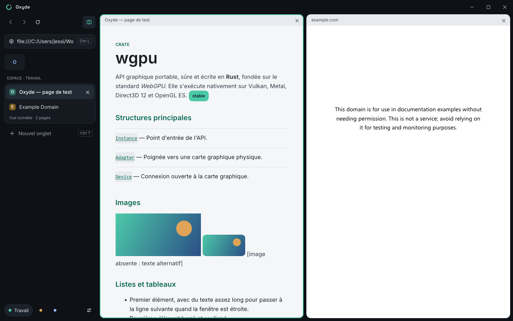

# Oxyde

Navigateur web écrit en Rust : une réécriture de l'architecture de Chromium (Blink, V8, cc, //net…)
avec du code Rust et des bibliothèques Rust uniquement. Cible actuelle : Windows.

Maquette de référence : « Oxyde — navigateur Rust » (Claude Design).



## Lancer

```bash
cargo run -p oxyde -- https://example.com
```

```bash
cargo run -p oxyde -- tests/pages/demo.html --split https://example.com --pin https://docs.rs
```

Rendu hors écran (capture de la fenêtre, ou de la page seule avec `--page-only`) :

```bash
cargo run -p oxyde -- --screenshot capture.png --size 1440x900 tests/pages/demo.html
```

Arbre DOM au format des tests html5lib :

```bash
cargo run -p oxyde -- --dump-dom tests/pages/demo.html
```

### Raccourcis

| Raccourci | Action |
|---|---|
| Ctrl L, Ctrl K | saisir une adresse ou une recherche |
| Ctrl V, Ctrl A | coller, tout sélectionner (pendant la saisie) |
| Ctrl T / Ctrl W | nouvel onglet / fermer l'onglet |
| Ctrl Maj T | rouvrir le dernier onglet fermé |
| Ctrl Maj P | épingler ou désépingler l'onglet |
| Ctrl Tab | onglet suivant |
| Ctrl R, F5 | actualiser |
| Alt ← / Alt → | page précédente / suivante |

Une saisie qui n'est pas une adresse lance une recherche sur DuckDuckGo (version HTML, qui
fonctionne sans JavaScript). Le choix du moteur sera un réglage de l'écran Paramètres.

## Architecture

Un crate par bloc de Chromium. La chaîne de rendu d'une page :

```
octets ─ oxyde_net ─▶ oxyde_html ─▶ oxyde_dom ─▶ oxyde_css ─▶ oxyde_layout ─▶ oxyde_paint ─▶ oxyde_gpu
         (//net)      (analyseur)   (arbre)      (cascade)    (LayoutNG)      (liste          (Vello, wgpu,
                                                               + oxyde_text    d'affichage)    Direct3D 12)
                                                                 (Parley)
```

| Crate | Rôle | Équivalent Chromium | État |
|---|---|---|---|
| `oxyde` | exécutable : fenêtre, onglets, espaces, chargements, accessibilité | `chrome/` | fonctionne, mono-processus |
| `oxyde_ui` | interface dessinée d'après la maquette | Views | écrans Fenêtre principale, Nouvel onglet, Pages d'erreur |
| `oxyde_content` | page : du HTML à la liste d'affichage, décodage d'images, DOM exposé aux scripts | `content/renderer` | fonctionne |
| `oxyde_net` | HTTP/1.1, HTTP/2, TLS | `//net`, BoringSSL | GET, redirections ; voir limites |
| `oxyde_html` | tokenizer + construction d'arbre WHATWG | analyseur HTML de Blink | l'essentiel du standard |
| `oxyde_dom` | arbre de nœuds en arène | DOM de Blink | modifiable par script |
| `oxyde_css` | syntaxe, sélecteurs, cascade | moteur de style de Blink | ~40 propriétés |
| `oxyde_layout` | blocs, flux en ligne, éléments remplacés, fragments | LayoutNG | bloc + en ligne ; voir limites |
| `oxyde_text` | polices, mise en forme, coupure de lignes | HarfBuzz, ICU | via Parley / HarfRust / ICU4X |
| `oxyde_paint` | liste d'affichage | paint de Blink | rectangles, bordures, texte, images |
| `oxyde_gpu` | rastérisation | Skia, Dawn | Vello sur wgpu |
| `oxyde_js` | moteur JavaScript : analyseur, bytecode à registres, interpréteur, ramasse-miettes, modules, expressions rationnelles | V8 (Ignition, Irregexp) | 83,5 % de test262 ; voir limites |
| `oxyde_bindings` | générateur de liaisons Web IDL : analyse des fichiers `.webidl`, table des interfaces du DOM | bindings de Blink | interfaces générées ; corps des opérations encore écrits à la main |
| `oxyde_test262` | lanceur de la suite de conformité ECMAScript | `test262` de V8 | fonctionne |
| `oxyde_wpt` | lanceur des Web Platform Tests (`testharness.js`) | `wptrunner` | fonctionne pour `dom/` |
| `oxyde_ipc` | messages entre processus | Mojo | **réservé — jalon 5** |
| `oxyde_sandbox` | bac à sable Windows | `//sandbox/win` | **réservé — jalon 5** |
| `oxyde_compositor` | calques, défilement, animations | cc, Viz | **réservé — jalon 6** |
| `oxyde_bench` | bancs d'essai et rapport publié | Telemetry, perf bots | fonctionne |
| `oxyde_platform` | abstraction du système | `//ui/base`, `//base` | **réservé — jalon 10** |

## Avertissements

- **Pas de bac à sable ni d'isolation des sites** : tout tourne dans un seul processus. Ne pas
  utiliser Oxyde pour naviguer sur des sites non fiables ni pour des données sensibles.
- **TLS** : le fournisseur cryptographique `rustls-rustcrypto` est une préversion non auditée,
  retenue pour rester en Rust pur. À réévaluer avant toute diffusion.
- **JavaScript partiel** : `oxyde_js` exécute les scripts classiques (classes, fermetures,
  déstructuration, `Map`/`Set`, JSON, `Symbol`, itérateurs, générateurs, `Promise`,
  `async`/`await`, générateurs async, expressions rationnelles, `BigInt`, tableaux typés, membres
  privés et blocs statiques de classe, `Proxy`, descripteurs de propriétés, mode strict) et les pages peuvent modifier le DOM, écouter
  `click`, poser des minuteurs, appeler `fetch` (`GET` seulement) et charger des modules
  (`<script type="module">`, `import`/`export`, `import()`, `await` de premier niveau). Manquent encore `XMLHttpRequest`, les
  formulaires et une grande partie du DOM : la plupart des sites réels ne fonctionnent donc
  pas encore. Conformité mesurée : 83,5 % de test262
  ([conformance/test262.md](conformance/test262.md)) ; 92,4 % des membres des interfaces du DOM
  décrites par l'IDL d'Oxyde sont disponibles ([conformance/dom.md](conformance/dom.md)) ; sur le
  dossier `dom/` des Web Platform Tests, 282 fichiers de test entièrement réussis sur 693 (40,7 %)
  ([conformance/wpt.md](conformance/wpt.md)).
- **Processeur au repos avec un pilote AMD** : sur Radeon (pilote 26.10.1), un fil interne du
  pilote graphique (`amdvlk64.dll` en Vulkan, `amdxc64.dll` en Direct3D 12) occupe un cœur en
  permanence après quelques images présentées. Le code d'Oxyde, lui, dort entre deux
  événements ; cause exacte non élucidée.
- **Rien n'est conservé d'une session à l'autre** : onglets épinglés, espaces et onglets fermés
  sont perdus à la fermeture (persistance prévue au jalon 7).

Les écarts connus par rapport aux standards sont listés dans [conformance/README.md](conformance/README.md)
et en tête de chaque crate (« LIMITES CONNUES »).

## Règle « 100 % Rust »

Aucune dépendance C ou C++ compilée. Seules exceptions : les API du système appelées via
`windows-rs` / `windows-sys` (Direct3D 12, fenêtres, sockets, presse-papiers, UI Automation).
`unsafe` est interdit dans tous les crates du workspace (`unsafe_code = "forbid"`).
`cargo deny check` fait respecter cette règle ([deny.toml](deny.toml)) pour la cible Windows.
Sur Android et Linux, `winit` amène du code C : à traiter avec les portages du jalon 10.

## Polices

Inter, Space Grotesk et JetBrains Mono sont embarquées dans l'exécutable depuis `assets/fonts/`.
Elles proviennent du dépôt `google/fonts` et sont distribuées sous licence SIL Open Font License 1.1
(texte dans chaque dossier, `OFL.txt`).

## Vérifications

```bash
cargo fmt --all -- --check
```

```bash
cargo clippy --workspace --all-targets -- -D warnings
```

```bash
cargo test --workspace
```

```bash
cargo deny check
```

## Bancs d'essai

Performances de la chaîne de rendu, sécurité TLS (badssl.com), vie privée (en-têtes envoyés) et
état des bancs publics (BrowserBench, APEXMark, Web Platform Tests, test262…) :
**[docs/BANCS.md](docs/BANCS.md)**. Pour régénérer le rapport :

```bash
cargo run -p oxyde_bench --release -- tout --publier
```

## Jalons

1. **Socle** — fait.
2. **Premier pixel** — fait : HTML, CSS, blocs et texte, défilement, images PNG / JPEG / WebP / GIF.
3. **Interface de la maquette** — fait : fenêtre principale (barre de titre, onglets, onglets
   épinglés, espaces, barre d'adresse, vue scindée), page Nouvel onglet, pages d'erreur,
   accessibilité du pourtour via AccessKit, polices de la maquette embarquées.
4. JavaScript (`oxyde_js`, Web IDL, DOM scriptable)
5. Multi-processus et bac à sable
6. Mise en page complète (flex, grille, tableaux, flottants, positionnement) et compositeur
7. Fonctions du navigateur (paramètres, historique, favoris, téléchargements, mots de passe…)
8. Performances JavaScript (compilateurs à la volée, ramasse-miettes générationnel, WebAssembly)
9. Plateforme web étendue (stockage, média, WebGL/WebGPU, WebRTC, DevTools, extensions, PDF)
10. Linux, macOS, Android, iOS/iPadOS
